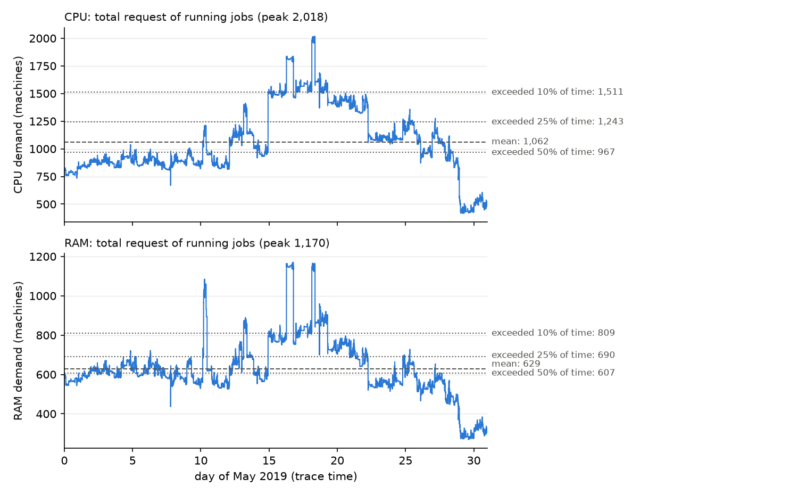
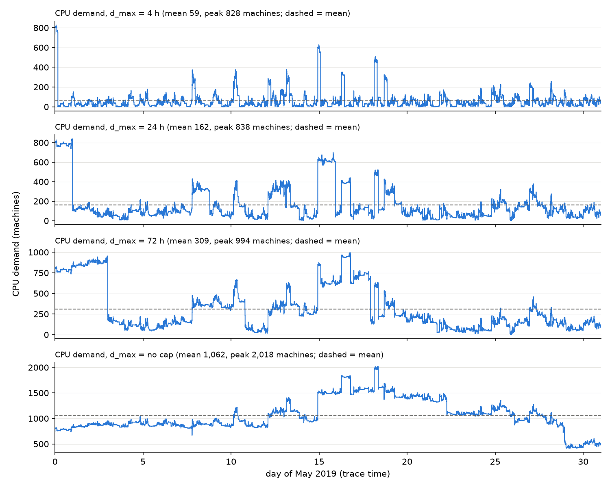

# Week 32: data audit and a simpler cluster rule (diagnosis only)

No model was run. No config was changed. All numbers come from two scripts:

* `scripts/week32/data_audit.py` (local data, writes every number to `audit_numbers.md`);
* `scripts/week32/bq_checks.py` (BigQuery, cell a).

**Unit.** A request is measured in **machines**. 1.0 = the largest machine of the trace. Google divides every
CPU and RAM value by the capacity of its largest machine (Google doc, "Resource units"). The label
"1.0 = 64 cores / 256 GB" is our own. It does not come from Google.

**Words used below.**

* *Job*: one collection of the trace (`collection_id`).
* *Instance*: one task of a job. A job has 1 or more instances.
* *Request of a job*: the SUM of the requests of its instances.
* *Demand at time t*: the sum of the requests of all jobs running at t.
* *Level exceeded X% of the time*: the demand value that is passed during X% of the month.

---

## 1. Errors found

One line each: **what**, effect, fix.

1. **The sample is not random.** It favours jobs with many instances (section 8a). Effect: 39.5% of our jobs have
   one instance. In the whole cell, 78.0% do. A rough reweighting gives a mean request about 2.2× too high.
   Fix: sample `collection_id`s uniformly from `collection_events`.
2. **Job times are 6 h 50 min early against the price data.** `request_time = 2019-05-01 00:00 + t`, but Google says
   t = 600 s is 1 May 2019 00:00 **PDT** (= 07:00 UTC). The grid file is in UTC. Effect: each job gets the price and
   carbon of 6 h 50 min earlier (`energy.py: GridData.lookup`). Fix: time = 2019-05-01 07:00 UTC + (t − 600 s).
3. **Snapping halves the work once all jobs are kept.** On all jobs, the 32 hardware profiles cut total CPU-hours by
   49.7% (RAM-hours by 44.2%). Effect: the model sees half the load. Fix: do not snap the request used for capacity,
   energy and value, or use many more profiles.
4. **The code limits d_max.** `data.py: _compute_d_max_steps` sets d_max ≤ 0.05·T and stops if d_max/T > 0.10.
   T = 459.5 h on all jobs. Effect: 72 h and "no cap" would stop the run. 24 h becomes 23.0 h.
   Fix: pick d_max ≤ 23 h, or change the rule on purpose.
5. **The duration cap is not applied everywhere.** `data.py: _build_job_arrays` caps only `duration_steps`
   (time in the cluster). Bids, energy and carbon use the full `duration_hours`. Effect: a capped job pays and
   pollutes for its full length but holds the cluster only until d_max. Fix: use one duration everywhere.
6. **Jobs cut at the borders of the trace carry half the work.** 600 jobs (2.0%) started before the trace or are
   still running at the end. They hold 47.5% of the CPU-hours (section 8e). The 430 that started before the trace
   all "arrive" at 00:05. Effect: a false spike at day 0. With d_max = 4 h this spike is the peak (fig. 2), so
   f = cluster / peak is distorted. Fix: mark these jobs, and treat them as starting load, not as arrivals.
7. **The 300k file used the old query.** It summed the request over **all events** of each instance, not one
   event per instance (section 6). Effect: requests 2.0× to 22.7× too large. The model does not use this file
   (`data.batch_csv` = 30k). Fix: delete it, or rebuild it with `fetch_data.py`.
8. **"64 cores / 256 GB" is built into the dollar values.** `bid.py` and `energy.py` multiply every request by
   64 and 256 (section 9). Effect: bid cost, power, energy and carbon all scale with an arbitrary factor. With no
   filters, a 440-machine job becomes 28,000 cores. Fix: state a machine size as an assumption, or a cluster size
   in physical units.
9. **The "current regime" numbers in the task are in the wrong unit.** 25.7 / 67.0 are cores / GB under the 64/256
   label. In machines the regime is **0.401 CPU / 0.262 RAM** (`configs/regime_small_cluster.yaml`).
   Fix: write 0.401 / 0.262 machines.
10. **I could not reproduce the context numbers 1,144 and 2.77.** With all jobs, the mean CPU demand is
    1,062 machines (peak 2,018). After the filters the mean is 2.2, and the 0.70 quantile is 2.68. The old numbers
    may use another time window or statistic. I cannot tell which.
11. **Alloc sets are in the sample.** An alloc set is a reservation that other jobs run inside. 317 alloc sets and
    703 jobs inside them are counted, so some resources are counted twice. Effect: small (≤ 1% of CPU).
    Fix: drop alloc sets.
12. **`actual_cpu_hours` assumes every usage window lasts 5 min.** Google says windows can be shorter. Effect: the
    value is too high (median 1.6× request × duration). The column is not used downstream. Fix: drop it, or use
    `end_time − start_time`.
13. **Priority 351–359 goes to tier 5.** Google says production is 120–359. Effect: none (0 jobs here).
    Fix: use 359 as the bin edge.

---

## 2. Tables (tasks 1–6)

### Task 1. Outlier filters (`dlent_rt/preprocess.py: handle_outliers`)

The code **drops** jobs (`outliers.policy: "drop"`). It does not clip them. It computes the thresholds on all
29,670 jobs. A job is dropped if its CPU request > q0.90, **or** its RAM request > q0.90, **or** its duration >
q0.95.

The thresholds are:

* CPU request > **3.2198** machines;
* RAM request > **1.9271** machines;
* duration > **3.9733 h**.

**Table 1. What each filter removes**

| filter | jobs removed | share of jobs | share of CPU-hours | share of RAM-hours |
|---|---|---|---|---|
| CPU request > 3.22 | 2,967 | 10.0% | 92.6% | 90.3% |
| RAM request > 1.93 | 2,967 | 10.0% | 88.8% | 92.1% |
| either request (resource filter) | 3,164 | 10.7% | 92.8% | 93.1% |
| duration > 3.97 h (duration filter) | 1,481 | 5.0% | 98.0% | 97.8% |
| **both filters together** | **4,362** | **14.7%** | **99.79%** | **99.76%** |

The filters keep 25,308 jobs (85.3%). Those jobs hold only 0.21% of the CPU-hours.

**Table 2. Hardware snapping** (`preprocess.py: fit_hardware_catalogue`, `HardwareCatalogue.assign`;
`data.py: _build_job_arrays` sets A = profile).

Snapping replaces each request by the nearest of 32 standard profiles.

| jobs | moved by > 5% | total CPU request | total RAM request | CPU-hours | RAM-hours |
|---|---|---|---|---|---|
| after filters (today), 25,308 | 95.1% | −3.2% | −3.6% | −1.2% | −6.5% |
| all jobs, 29,670 | 95.2% | −8.1% | −9.2% | **−49.7%** | **−44.2%** |

### Task 2. Demand over the month, all jobs, real durations

**Table 3. Demand in machines.** Time window: 1 May 00:05 to 1 June 00:09 (744 h).

| resource | mean | peak | exceeded 10% of time | exceeded 25% | exceeded 50% |
|---|---|---|---|---|---|
| CPU | 1,061.9 | 2,018.1 | 1,511.2 | 1,242.7 | 967.0 |
| RAM | 629.0 | 1,170.0 | 809.2 | 690.3 | 606.6 |

For comparison, after the filters the CPU mean is 2.2 and the peak is 30.6 (snapped).

### Task 3. Duration cap d_max

T = 459.5 h, the online horizon the code would use on all jobs (n0 = 10,000).

**Table 4. Effect of the cap on the work**

| d_max | d_max / T | jobs cut | CPU-hours kept |
|---|---|---|---|
| 4 h | 0.009 | 1,417 | 5.5% |
| 24 h | 0.052 | 809 | 15.2% |
| 72 h | 0.157 | 647 | 29.1% |
| no cap | 1.619 (longest job / T) | 0 | 100% |

The code accepts d_max/T ≤ 0.05, so it would turn 24 h into 23.0 h. It refuses 72 h and "no cap" (error 4).

**Table 5. CPU demand with the cap (machines)**

| d_max | mean | peak | exceeded 10% | exceeded 25% | exceeded 50% |
|---|---|---|---|---|---|
| 4 h | 58.9 | 827.5 | 120.1 | 66.8 | 33.3 |
| 24 h | 161.8 | 838.5 | 376.9 | 171.7 | 103.1 |
| 72 h | 308.8 | 994.4 | 788.3 | 397.2 | 205.7 |
| no cap | 1,061.9 | 2,018.1 | 1,511.2 | 1,242.7 | 967.0 |

**Table 6. RAM demand with the cap (machines)**

| d_max | mean | peak | exceeded 10% | exceeded 25% | exceeded 50% |
|---|---|---|---|---|---|
| 4 h | 42.0 | 600.3 | 76.7 | 45.9 | 23.4 |
| 24 h | 110.1 | 600.3 | 258.2 | 112.8 | 68.4 |
| 72 h | 194.1 | 737.7 | 566.2 | 260.2 | 124.8 |
| no cap | 629.0 | 1,170.0 | 809.2 | 690.3 | 606.6 |

### Task 4. The new cluster rule

**Rule:** cluster = the demand level exceeded X% of the time, for each resource. f = cluster / peak.

**Test:** first come, first served (FCFS). Jobs arrive in time order. A job is accepted if it fits now, on CPU and
RAM. Otherwise it is rejected. There is no queue, no reward and no thinning. "Full" means CPU or RAM is at least
95% used.

**Table 7. Cluster size (machines) and f**

| d_max | X | cluster CPU | cluster RAM | f CPU | f RAM |
|---|---|---|---|---|---|
| 4 h | 10% | 120.1 | 76.7 | 0.145 | 0.128 |
| 4 h | 25% | 66.8 | 45.9 | 0.081 | 0.076 |
| 4 h | 50% | 33.3 | 23.4 | 0.040 | 0.039 |
| 24 h | 10% | 376.9 | 258.2 | 0.450 | 0.430 |
| 24 h | 25% | 171.7 | 112.8 | 0.205 | 0.188 |
| 24 h | 50% | 103.1 | 68.4 | 0.123 | 0.114 |
| 72 h | 10% | 788.3 | 566.2 | 0.793 | 0.767 |
| 72 h | 25% | 397.2 | 260.2 | 0.399 | 0.353 |
| 72 h | 50% | 205.7 | 124.8 | 0.207 | 0.169 |
| no cap | 10% | 1,511.2 | 809.2 | 0.749 | 0.692 |
| no cap | 25% | 1,242.7 | 690.3 | 0.616 | 0.590 |
| no cap | 50% | 967.0 | 606.6 | 0.479 | 0.518 |

**Table 8. Jobs that can never fit** (larger than the cluster on CPU or RAM)

| d_max | X | jobs | their share of CPU-hours |
|---|---|---|---|
| 4 h | 10% / 25% / 50% | 12 / 30 / 84 | 20.6% / 28.4% / 41.1% |
| 24 h | 10% / 25% / 50% | 3 / 9 / 14 | 5.4% / 23.4% / 25.5% |
| 72 h | 10% / 25% / 50% | 0 / 3 / 8 | 0.0% / 2.9% / 21.4% |
| no cap | 10% / 25% / 50% | 0 / 0 / 0 | 0% / 0% / 0% |

**Table 9. FCFS result**

| d_max | X | jobs accepted | CPU-hours served | time ≥ 95% full |
|---|---|---|---|---|
| 4 h | 10% | 98.6% | 60.3% | 2.0% |
| 4 h | 25% | 97.2% | 44.2% | 3.2% |
| 4 h | 50% | 93.2% | 25.0% | 6.9% |
| 24 h | 10% | 99.5% | 74.6% | 2.8% |
| 24 h | 25% | 98.3% | 48.8% | 4.5% |
| 24 h | 50% | 97.6% | 35.2% | 6.7% |
| 72 h | 10% | 99.8% | 88.4% | 7.4% |
| 72 h | 25% | 99.2% | 60.7% | 8.7% |
| 72 h | 50% | 97.1% | 35.9% | 12.7% |
| no cap | 10% | 99.8% | 97.1% | 13.0% |
| no cap | 25% | 99.6% | 90.1% | 18.5% |
| no cap | 50% | 99.0% | 70.4% | 25.3% |

**Kash's question: the accepted share at f = 1.** Under the new rule, f = 1 means cluster = peak. Then every job
fits, by definition: 100% of jobs and 100% of CPU-hours, for every d_max.

**Table 10. Today's regime, same FCFS** (25,308 filtered jobs, snapped requests, d_max = 3.97 h)

| case | cluster CPU | cluster RAM | f CPU | f RAM | jobs that never fit | their CPU-hours | jobs accepted | CPU-hours served | time ≥ 95% full |
|---|---|---|---|---|---|---|---|---|---|
| old rule at f = 1 (cluster = q0.70 level) | 2.676 | 1.744 | 0.088 | 0.166 | 0 | 0% | 90.6% | 51.1% | 5.1% |
| **our small cluster, f = 0.15** | **0.401** | **0.262** | 0.013 | 0.025 | 3,838 | 84.0% | **70.5%** | **8.1%** | 5.0% |

Here f is cluster / peak. It is not the old f, which was a fraction of the q0.70 level. The check
0.15 × q0.70 level = 0.401 / 0.262 holds exactly (assert in the script).

### Task 5. BigQuery checks (cell a)

**Bytes scanned (dry run first, every query).**

| query | what | GB | run? |
|---|---|---|---|
| a | collection_type of our 29,670 | 0.34 | yes |
| lost | the 330 jobs lost in the merge | 0.67 | yes |
| pop | all collections of cell a (type) | 0.67 | yes |
| p0 | instances per collection, all of cell a | 27.5 | yes |
| b | first-event vs all-event requests, request changes (all of cell a) | **82.4** | **no: over 50 GB** |
| c | real peak of 500 jobs from instance spans | **311.1** | **no: over 50 GB** |

Queries b and c wait for your approval. Without them, three checks are still open: **5c** (how much "all instances
run together" overstates demand), **8c** (request updates), and the exact check of section 6.

**5a. Job or alloc set**

| kind | collections | share | share of requested CPU |
|---|---|---|---|
| job | 29,353 | 98.9% | 99.6% |
| alloc set | 317 | 1.1% | 0.4% |
| job that runs inside an alloc set | 703 | 2.4% | 0.6% |

**5b. Instances per job (our sample)**

| instances | jobs | share of jobs | share of requested CPU |
|---|---|---|---|
| 1 | 11,710 | 39.5% | 0.3% |
| 2–10 | 6,675 | 22.5% | 1.0% |
| 11–100 | 6,203 | 20.9% | 6.0% |
| 101–1000 | 4,129 | 13.9% | 38.3% |
| > 1000 | 953 | 3.2% | 54.4% |

The median is 3 instances and the maximum is 48,077. Jobs with more than 100 instances hold 93% of the requested
CPU. This is why "SUM over instances" matters so much (5c is still open).

**5c.** Not run (311 GB). See the table of bytes above.

**5d. Trace time and clock time.** Google doc, *Google cluster-usage traces v3*, quoted:

> "Each record has a timestamp, which is in microseconds since 600 seconds before the beginning of the trace
> period […] (i.e., an event 20 seconds after the start of the trace would have a timestamp=620s)."

> "A time of 0 represents events that occurred before the beginning of the trace window."

> Table "Traces": "2019-05-a | Trace start (t=600s): 1 May 2019 00:00 PDT | Timezone: America/New York".

So clock time = 1 May 2019 00:00 PDT + (t − 600 s) = **1 May 2019 07:00 UTC + (t − 600 s)**.

Our code (`scripts/data/data_generator.py: load_google_traces`) uses `2019-05-01 00:00 + t` with no time zone. The
grid file (`data/grid_data_may_2019.csv`) is in UTC (`timestamp_utc`). **It is not right**: our job times are
6 h 50 min too early, so each job is matched to the wrong hourly price (error 2). Cell a is in America/New York, the
same time zone as PJM, so PJM is a sensible price region.

### Task 6. How the 300k file was built

* The file is not in this repo's git history: `data/` is gitignored. Its MD5 is identical to
  `cloud_pricing_sim/data/processed/batch_may2019_300k.csv` (made 14 May, 17:11).
* It was written by `cloud_pricing_sim/scripts/build_processed_dataset.py`. That script reads `raw_events_30k.csv`
  (14 May, 17:09), the output of `cloud_pricing_sim/scripts/fetch_30ksample.py`. **Neither script is in git**
  (untracked files in `cloud_pricing_sim`), so the exact version cannot be proved from git history.
* That fetch script uses `LIMIT 300000` and
  `SUM(resource_request.cpus) … FROM instance_events WHERE collection_id IN UNNEST(@job_ids) GROUP BY collection_id`.
  There is no `ROW_NUMBER … rn = 1` and no event-type filter. So **yes, it is the old query from before "FIX 1"**.
  It adds every event of every instance (SUBMIT, QUEUE, ENABLE, SCHEDULE, FINISH, …).
* **Does this explain 2–23×?** Mostly yes. 7,136 jobs are in both files. The ratio 300k / 30k (CPU) is 2.01 at
  the 10th percentile, 5.05 at the median and 22.74 at the 90th. Every ratio is ≥ 1, and durations are identical.
  The events per instance on the same jobs are 5.0, 6.0 and 14.2 at the same percentiles. Their rank correlation
  with the ratio is 0.56. The match is close but not exact: some events carry no request, and some instances change
  their request. Query b (82 GB) would give the exact sum and close this.

---

## 8. Fetch step audit (`scripts/data/fetch_data.py`, `scripts/data/data_generator.py`)

**8a. Sampling.**

* *Code:* `SELECT DISTINCT collection_id FROM instance_events WHERE resource_request.cpus IS NOT NULL AND
  RAND() < 0.05 LIMIT 30000`.
* *Correct?* No. RAND() is applied to each event row, so a job with many rows has many chances to enter. A job
  with n rows enters with chance 1 − 0.95ⁿ. `LIMIT` then keeps an arbitrary 30,000.
* *Effect:* see the table below.

| set | collections | median instances | mean instances | with 1 instance | with > 100 instances |
|---|---|---|---|---|---|
| all of cell a | 5,213,668 | 1 | 15.4 | 78.0% | 1.7% |
| fair random sample (29,670 ids) | 29,670 | 1 | 13.5 | 78.0% | 1.6% |
| our sample | 29,670 | 3 | 135.5 | 39.5% | 17.1% |

* *Share of the cell:* we have **0.57% of the collections** (29,670 of 5.21 million) and **5.0% of the
  instances**.
* *Share of requested CPU:* this needs query b (82 GB), so it is still open.
* Cell a has 5,176,566 jobs and 36,174 alloc sets.

**8b. Jobs lost in the merge (30,000 → 29,670).**

* *Code:* inner merge of events and usage on `collection_id`.
* *Who is lost:* all 330 have no row in `instance_usage`. 293 were never scheduled. For 305 the last event is KILL.
  Others end in SUBMIT (6), LOST (5), ENABLE (5), FINISH (4), QUEUE (3) or SCHEDULE (2). 5 are alloc sets.
* *Correct?* Yes for a model of running jobs: these jobs never used resources. The 37 that were scheduled but have
  no usage may have run on dedicated machines. Google: "there are no entries in the InstanceUsage table for
  instances running on dedicated machines".
* *Effect:* small (1.1% of the sample).

**8c. Request changes over time.**

* *Code:* takes the first event of each instance.
* *Google:* "UPDATE_PENDING: a thing's scheduling class, resource requirements, or constraints were updated while
  it was waiting to be scheduled." "UPDATE_RUNNING: … updated while it was running."
* *So:* requests can change over time.
* *How often in our sample:* open. It needs query b (82 GB).

**8d. Duration.**

* *Code:* duration = max(`end_time`) − min(`start_time`) over all usage windows of the job.
* *Queue time:* usage windows exist only while an instance runs. Google: "average usage across the portion of the
  window in which the instance is scheduled". So the **queue time is excluded**. This is what the model needs: the
  time a job holds resources after it is admitted.
* *But:* the span runs from the first instance start to the last instance end. If instances run one after another,
  the model holds the SUM of all requests for that whole span. This overstates demand. Query c measures it.

**8e. Jobs cut at the trace borders.**

| jobs | count | share of jobs | share of CPU-hours | share of RAM-hours |
|---|---|---|---|---|
| started before the trace (start < 600 s) | 430 | 1.45% | 36.3% | 45.8% |
| still running at the end | 460 | 1.55% | 30.0% | 33.8% |
| either | 600 | 2.02% | 47.5% | 53.7% |

"Still running at the end" means the last usage window ends less than 5 min before the trace end. 290 jobs are
both: they run for the whole month.

**8f. Priority tiers.**

* *Code:* `pd.cut(bins=[-1, 99, 115, 119, 350, inf], labels=[1..5])`.
* *Google doc ("Priority"), quoted:* "Free tier (priorities ≤ 99) … Best-effort Batch (beb) (priorities 100–115) …
  Mid-tier (priorities 116–119) … Production tier (priorities 120–359) … Monitoring tier (priorities ≥ 360)".
* *Result:* tiers 1–3 match. Tier 4 ends at 350 in the code but at 359 in the doc. Effect: none, since no job in
  our sample has a priority of 351–359. 39 of the 30,000 fetched jobs are in the monitoring tier (≥ 360).

**8g. `actual_cpu_hours`.**

* *Code:* `SUM(average_usage.cpus * 5.0 / 60.0)`, so it assumes every window is 5 min.
* *Google:* "The windows are typically 5 minutes (300s) long, although may be shorter if the instance starts,
  stops, or is updated within that time period."
* *Correct?* No. It overcounts short windows.
* *Used downstream?* No: only `fetch_data.py` and `data_generator.py` mention it. The model never reads it.

---

## 9. Assumptions used downstream

| assumption | where used (file: function) | what it computes | what changes with "machines" and no filters |
|---|---|---|---|
| 1.0 = 64 cores / 256 GB | `dlent_rt/energy.py: compute_power_kw`, `compute_energy_kwh` | power w_j (kW), energy (kWh), then C_elec and carbon K | Everything scales with the label. With no filters, big jobs (up to 440 machines) get huge power and energy. A machine size must be stated as an assumption. |
| same | `dlent_rt/bid.py: synthesize_lognormal` (`LognormalBidParams`) | bid cost base c_j = (U_0 + γ1·cores + γ2·GB)·duration, then bids v and φ | c_j grows with request size. γ1, γ2 and U_0 were calibrated with 64/256 on filtered jobs, so U_0 must be recalibrated (`scripts/calibrate_u0.py`). |
| same | `dlent_rt/phase0.py: _make_energy_params`, `_synthesize_bids`, `_compute_job_energy`, `_compute_job_power` | passes the label to the two above | as above |
| same | `dlent_rt/reward.py: quantile_linear` (s_C = D_q / K_q) | carbon price s_C | s_C is a ratio of dollar and carbon quantiles. It moves when the value and carbon distributions change (no filters, other label). |
| same | `dlent_rt/config.py` (EnergyModel), `configs/default.yaml`, `configs/binding_capacity.yaml` `energy_model` | defaults `spec_cpu_core: 64`, `spec_ram_gb: 256` | the comment "in Google trace" is wrong: the label is our own |
| same, in reports only | `configs/regime_small_cluster.yaml` (comment), `scripts/capacity_regime.py`, `scripts/small_cluster_nofilter.py`, `scripts/capacity_from_rho.py`, `notebooks/src/01_phase0_diagnostics.py`, `phase0_regime_check.py`, `capacity_grid_sweep.py`, `capacity_scan.py`, week-30 reports and notebooks 01 / 03 | cluster shown in cores and GB | report in machines instead |
| a request is a fraction of one machine | the comments "cores per 1.0 normalized CPU" in `energy.py`, `bid.py`, `config.py`; the power model uses p_core × 64 × A | a job is treated as part of one 64-core machine | False after SUM over instances: 10% of jobs ask for more than 3.2 machines, and the largest for 440. The model must allow jobs larger than one machine. |
| outlier filters | `dlent_rt/data.py: load_dataset` calls `preprocess.py: handle_outliers`; `config.outliers` | which jobs exist; also T and the H / stream split | No filters → 29,670 jobs, T = 459.5 h instead of 398.0 h |
| same | `data.py: _compute_d_max_steps` (`d_max_quantile: 1.0` = longest kept job) | d_max = 3.97 h today | Without the filter, d_max = longest job, capped at 0.05·T = 23.0 h. The time cap becomes the real filter. |
| same | `data.py: load_dataset` (xi warning), `phase0.py: _system_constants` | data xi = max a_max / c, data gamma | data xi is much larger (jobs up to 440 machines). xi and gamma stay forced, so the online loop does not change. |
| hardware snapping | `preprocess.py: fit_hardware_catalogue`, `assign`; `data.py: _build_job_arrays` (A = profile) | the A seen by everything: capacity, gate, energy, bids, types | On all jobs the CPU-hours drop by 49.7% (Table 2) |
| same | `phase0.py: assign_type_ids`, type volume v = A_type · d̄, `hw_floor` in the gamma v_min term; `models/core/stream.py`; `models/policy.py` | job types and LP volumes | types and volumes change with the profiles |
| capacity modes | `data.py: _size_capacity` (`fraction_of_volume`, `fraction_of_peak`, `fraction_of_concurrency_quantile`, `from_amax`, `absolute`) | cluster c | The new rule is `fraction_of_concurrency_quantile` with fraction = 1 and quantile = 1 − X. It sizes on snapped A and capped durations, so it is close to, but not the same as, Table 7. |
| same | `configs/regime_small_cluster.yaml` (`absolute`: 0.401 / 0.262) | today's small cluster | replaced by the new rule |
| `drop_jobs_exceeding_capacity` | `data.py: load_dataset`; tests `test_capacity_drop.py`; several week-30 scripts | removes jobs larger than c | With the new rule, 0–84 jobs are larger than c (Table 8). Keeping them means the gate rejects them. |
| c in the theory | `phase0.py: _system_constants` (c_max in gamma, xi); `models/theory.py` (a_max_eff = xi·c); `models/core/error_params.py` (c_min); `lp_oracle.py: solve_lp_rs` | LP constraints, error terms | c grows from 0.4 to about 100–400 machines. With forced xi and gamma only c_min and the LP change. |

No thesis text is in this repo. I did not search outside it.

---

## 10. Definitions for the thesis

| term | current (wrong or unclear) | correct |
|---|---|---|
| job | "a job", often mixed with task | one collection of type job (`collection_type = 0`) in the Google trace. Alloc sets are not jobs. |
| task (instance) | not defined | one instance of a job; it runs on one machine. A job has 1 to 48,077 instances in our sample. |
| request and its unit | "fraction of a machine; 1.0 = 64 cores / 256 GB" | the SUM over the job's instances of each instance's first request, in machines (1.0 = the largest machine of the trace). It can be much larger than 1. |
| duration | "job duration in hours" | time from the start of the first running instance to the end of the last (usage windows). Queue time is not included. |
| cluster capacity and its rule | "f × q0.70 level after filters" (0.401 / 0.262) | per resource, the demand level exceeded X% of the time, computed on the same jobs and durations the model uses |
| d_max | "longest job after the outlier filter" (3.97 h) | the cap on the time a job holds the cluster; it must be ≤ 0.05·T in the code (23 h here), and the same duration must be used for value and energy |
| workload sample | "30,000 random jobs of May 2019" | 29,670 jobs of cell a. That is 0.57% of the cell's collections and 5.0% of its instances. **Not random**: it favours jobs with many instances. |
| share of the cell | not stated | 0.57% of collections, 5.0% of instances. Share of requested CPU: open (query b). |
| time | "2019-05-01 + microseconds" | 1 May 2019 07:00 UTC + (t − 600 s); local time of cell a is America/New York |

---

## What I would choose

**X = 10% and d_max = 24 h**, which the code turns into 23.0 h. The cluster is then about 377 CPU / 258 RAM
machines.

**One reason:** 24 h is the longest cap the code accepts (d_max ≤ 0.05·T). At X = 10% only 3 jobs can never fit,
yet the cluster still cannot serve 25% of the CPU-hours, so the admission rule has real work to do.

All these numbers will move once the sampling and the time base are fixed (errors 1 and 2).
