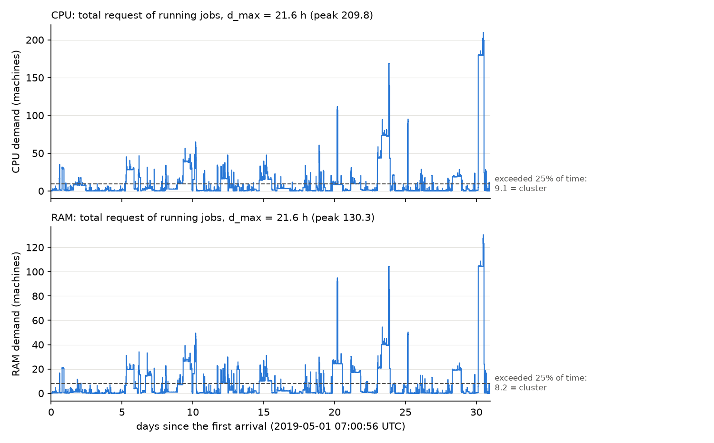

# Week 32, step 2: new fetch and a simple data pipeline (no model runs)

No model was run. `configs/default.yaml` and the old results are unchanged. The new path sits next to the old one:

* fetch: `scripts/data/fetch_v2.py`;
* build: `scripts/data/build_v2.py`;
* data file: `data/batch_v2_30k.csv`;
* config: `configs/regime_v2.yaml`;
* checks: `scripts/week32/data_v2.py`. Its numbers are in `data_v2_numbers.md`.

**Unit.** A request is in **machines**: 1.0 = the largest machine of the trace. "64 cores / 256 GB per machine"
is our own **declared assumption**, not a Google number. It is used only for bids and energy.

**The two rules.**

1. **Cluster size:** for each resource, the cluster is the demand level that is exceeded 25% of the time when every
   job is admitted.
2. **Duration:** every job uses one duration, min(real duration, d_max), for the time in the cluster, the bid and the
   energy.

---

## What changed and why

| what changed | why |
|---|---|
| New sample: 30,000 jobs chosen by a fixed hash of `collection_id` (FARM_FINGERPRINT, salt `dlent-rt-v2-2019a`) | The old sample favoured jobs with many instances. The hash gives the same sample every time. |
| Only jobs (`collection_type` 0) that ran (have usage rows) | Alloc sets are reservations, not jobs. Jobs that never ran use nothing. |
| Jobs cut at the trace borders are removed | We study jobs that start and end inside the month. |
| Time in UTC: 2019-05-01 07:00 UTC + (t − 600 s) | Google: t = 600 s is 1 May 2019 00:00 PDT. The price file is in UTC. |
| Priority tiers use bin edges −1, 99, 115, 119, **359** | Google: production is 120–359. |
| Request = SUM of the instances' first requests | As before, but now only over instances that ran. The real peak is stored too. |
| No outlier filter (`outliers.policy: none`) | The filters removed 99.8% of the work. |
| One duration everywhere (`time.cap_duration_everywhere`) | Before, the bid and the energy used the full duration but the cluster used the capped one. |
| d_max set in hours (`time.d_max_hours`) | Before, d_max was "the longest kept job". |
| Real request in the gate, capacity, bids and energy (`hardware.snap_requests: false`) | Snapping cut the work in half once all jobs are kept. Profiles now only build the type id. |
| New capacity mode `exceeded_share` (one parameter, 0.25) | The simple cluster rule. The old modes stay, for the old results. |
| Config keys `machine_cores`, `machine_ram_gb`; comments fixed | The size of a machine is our assumption. The old key names are still read. |

**Every switch is off by default.** With the old config the data path is **bit-identical**. I checked 60 arrays on the
real trace with `scripts/week32/fingerprint_dataset.py`: requests, durations, steps, capacity, d_max, xi, bids,
energy, power, prices and carbon, for both `default.yaml` (git HEAD) and `regime_small_cluster.yaml`. All 60 are equal.

---

## Where the code differs from the plan (the code wins)

1. **d_max = 23 h is not allowed.** The code caps d_max at 0.05 × T (`data.py: _compute_d_max_steps`). T = 431.5 h,
   so 0.05 × T = **21.57 h**. When 23 h is asked for, 21.57 h is used.
2. **"About 78% and 15.4" is a different set.** Those numbers count all collections of cell a in `instance_events`,
   including alloc sets and jobs that never ran. Our sample's own population (jobs that ran, not at the border)
   has 79.5% single-instance jobs and 14.05 instances per job. Our sample matches it (Table 1).
3. **The real peak is almost the same as the SUM.** So I did **not** switch to `real_peak_request`. The SUM
   overstates the work for a different reason: instances do not all run for the whole span (Table 3).
4. **The "request changed" flag cannot be trusted.** It is true for 100.0% of jobs, and 95.2% of jobs have UPDATE
   events. That is too many to be real resizing. More likely some event types carry a different value. Checking
   needs another `instance_events` scan (124 GB), which would take this step past 500 GB. I did not run it.
5. **Phase 0 still uses the profile for the type volume.** `phase0.py: build_type_space` takes `hw_profiles` from the
   k-means centroids, so the LP volume v = A_profile × d̄. The gate now uses the real A. The LP and the gate
   therefore see different sizes. **This changes Phase 0 and is an open decision.**
6. **The price file ends too early.** It stops at 1 June 03:00 UTC, but jobs arrive until 06:54 UTC. 233 jobs get
   the last hour's price, because `energy.py: GridData.lookup` clips the index.
7. **xi on the data is 19.3.** The largest request (175 machines) is 19 times the cluster. xi stays forced at 0.001,
   so this is hidden.
8. **The 25% rule makes most of the work impossible.** The 128 jobs larger than the cluster hold 84% of the CPU-hours
   (Table 5).

---

## Tables

### Task 1. The fetch

* The dry run of the two table scans: `instance_usage` **303.0 GB** + `instance_events` **123.6 GB** = **426.7 GB**,
  about $2.43 at $6.25 per TiB. That is below the 500 GB stop.
* Billed in the run: **442.4 GB** (the scans plus 15.7 GB of temporary-table reads), about $2.52, in 223 s.
* A job is "at the border" if its first usage starts before t = 600 s, or its last usage ends less than 300 s
  (one usage window) before the end of the trace.

### Task 2. The job file

`data/batch_v2_30k.csv` has 30,000 jobs. Arrivals run from 1 May 07:00:56 to 1 June 06:54:06 UTC.

* **`data_generator.py` was replaced, not fixed.** The new `scripts/data/build_v2.py` builds the new file.
  `data_generator.py` is unchanged, so the old file can still be rebuilt.
* **Priority tiers:** tier 1: 6,055 jobs, tier 2: 2,009, tier 3: 885, tier 4: 20,992, tier 5: 59.
* **Instances without a request: 0.**
* **Jobs whose request is 0 on CPU: 12.**

### Task 3. Is the sample fair?

**Table 1. Instances per job**

| set | jobs | with 1 instance | mean instances | median | with > 100 |
|---|---|---|---|---|---|
| **our new sample** | 30,000 | **79.9%** | **13.48** | 1 | 1.61% |
| its population (no border, with a request) | 5,125,385 | 79.5% | 14.05 | 1 | 1.64% |
| all jobs of cell a with usage (border included) | 5,146,808 | 79.4% | 14.41 | 1 | 1.66% |
| all collections of cell a (`instance_events`, step 1) | 5,213,668 | 78.0% | 15.43 | 1 | 1.72% |
| old sample (`batch_may2019_30k`) | 29,670 | 39.5% | 135.46 | 3 | 17.13% |

**Table 2. Share of the cell we hold**

| what | share |
|---|---|
| jobs of cell a that ran | 0.583% |
| summed CPU request of those jobs | 0.554% |
| summed RAM request | 0.553% |

* Border jobs are 21,423 of the 5.15 million (0.42%). They hold 3.0% of the summed CPU request.
* Check: the sample is exactly the 30,000 eligible jobs with the smallest hash.

### Task 4. SUM versus the real peak

* **Per job, the SUM equals the real peak for 99.5% of jobs.** For the 6,022 multi-instance jobs, SUM / peak is 1.00
  at the median, 1.00 at the 90th percentile and 1.03 at the 99th. The maximum is 2.3.
* **Instances of a job do run together. They just do not run for the whole span.**

**Table 3. Overstatement (CPU, machines)**

| what | SUM | real peak | real (each instance on its own span) | SUM / real |
|---|---|---|---|---|
| total request | 4,232.4 | 4,201.7 | – | 1.007 |
| CPU-hours (request × job span) | 15,298 | 15,285 | 7,341 | **2.08** |
| demand over time, mean | 20.57 | 20.55 | 9.87 | 2.08 |
| demand over time, peak | 209.79 | 209.60 | 178.47 | 1.18 |
| demand over time, level exceeded 25% | 27.32 | 27.30 | 15.38 | 1.78 |

**Decision:** keep the SUM as the request (`requested_cpu: CPU`). The real peak would change almost nothing.

**Open:** the job duration ("first start to last end") doubles the work. One fix keeps the request and uses a
shorter duration, CPU_hours_real / CPU. That is a choice for you. The file stores `CPU_hours_real` and
`RAM_hours_real` for it.

### Task 5. Pipeline and tests

The new keys, all off or old by default:

* `data.time_base` (`trace` | `utc`);
* `time.d_max_hours`;
* `time.cap_duration_everywhere`;
* `hardware.snap_requests`;
* `outliers.policy: none`;
* `capacity.mode: exceeded_share` with `capacity.exceeded_share`.

Tests:

* `tests/test_v2_pipeline.py`, new, 4 tests on the synthetic trace. With the new switches:
  * the gate, the capacity, the bids and the energy all use the same real request and the same capped duration;
  * the capacity equals the time-weighted 0.75 quantile of the demand;
  * `time_base: utc` refuses timestamps with no time zone, and converts New York time to UTC;
  * the old keys `spec_cpu_core` / `spec_ram_gb` still load.
* **Old numbers:** the 60-array fingerprint above is identical. The full suite passes on a clean checkout
  (HEAD + this change): **84 passed**.
* **Two tests fail on the working tree because of the uncommitted edit to `configs/default.yaml`, not because of
  this change.** They are `test_config_defaults.py::test_dataclass_defaults_equal_yaml` and
  `test_capacity_from_amax.py::test_other_modes_unchanged`. They read `default.yaml`, so they see fraction 0.30 /
  quantile 0.70 instead of the committed 0.40 / 0.80. On a clean checkout (HEAD + this change) they pass.

### Task 6. d_max

T = 431.5 h, the online horizon after the first n0 = 10,000 jobs.

**Table 4. How much work each cap keeps**

| d_max asked | d_max used | d_max / T | jobs cut | CPU-hours kept |
|---|---|---|---|---|
| 4 h | 4.00 h | 0.009 | 255 | 23.1% |
| 12 h | 12.00 h | 0.028 | 164 | 42.1% |
| 23 h | **21.57 h** (code ceiling) | 0.050 | 120 | 49.2% |

**Table 5. Cluster by the 25% rule.** Cores and GB use the declared 64 cores / 256 GB per machine.

| d_max | CPU (machines) | RAM (machines) | CPU cores | RAM GB | f CPU = cluster / peak | f RAM | jobs larger than the cluster | their CPU-hours |
|---|---|---|---|---|---|---|---|---|
| 4 h | 2.42 | 1.68 | 155 | 430 | 0.013 | 0.016 | 341 | 91.2% |
| 12 h | 7.69 | 5.35 | 492 | 1,371 | 0.037 | 0.041 | 139 | 85.0% |
| 21.57 h | 9.09 | 8.23 | 582 | 2,106 | 0.043 | 0.063 | 128 | 83.9% |

**Table 6. First come, first served** (admit a job if it fits now; no reward, no thinning)

| d_max | cluster | jobs accepted | CPU-hours served | time ≥ 95% full |
|---|---|---|---|---|
| 4 h | 25% rule | 98.4% | 6.9% | 1.1% |
| 4 h | f = 1 (cluster = peak) | 100% | 100% | 0.5% |
| 12 h | 25% rule | 99.0% | 12.5% | 1.3% |
| 12 h | f = 1 | 100% | 100% | 0.1% |
| 21.57 h | 25% rule | 99.4% | 14.8% | 0.8% |
| 21.57 h | f = 1 | 100% | 100% | 0.1% |

"Full" means CPU or RAM is at least 95% used.

**What the tables say.**

* Almost every job is small and fits: 98–99% of jobs are accepted.
* A few very large jobs carry most of the work and never fit the 25% cluster.
* Demand is spiky (figure). The level exceeded 25% of the time is far below the peak.

### Task 7. Bid model and u0

**What the old calibration assumed** (`scripts/calibrate_u0.py`, `configs/default.yaml`): U_0 = 23.926 is the
smallest U_0 at which 90% of the Phase 0 types with jobs have a positive reward r̃. It was found by bisection, with:

* σ = 0.3 and base-utility mode "log";
* γ1 = 0.0332 $/core-hour and γ2 = 0.00445 $/GB-hour;
* the **old data**: the biased sample, the outlier filters (25,308 jobs, all ≤ 3.97 h), snapped requests,
  64 / 256 per machine, and the job times shifted by 6 h 50 min, so different prices and carbon.

**What must be recalibrated or re-checked with the new data** (not done yet):

1. **U_0.** Same bisection, same 90% target, on `regime_v2.yaml`. Bids now use real requests (up to 175 machines)
   and capped durations up to 21.6 h, so the cost base c_j changes a lot.
2. **γ1, γ2.** Their comment says they were calibrated together with U_0 (about 3.3× GCP preemptible prices).
   At least re-check them, because U_0 depends on them.
3. **s_C, the carbon price.** It is recomputed by Phase 0 (`reward.py: quantile_linear`), not set by hand. It will
   move, because customer value, profit and carbon all change. Report the new value when Phase 0 runs.
4. **The hardware profiles and k\* (the types).** 80% of the new jobs are single-instance and tiny. Check how many
   types have jobs before trusting the per-type statistics.
5. **The regression snapshots** (`tests/data/*.npz`). The v2 path needs its own snapshot once a model run is
   approved.

---

## What I would choose for d_max

**d_max = 0.05 × T = 21.6 h**, the largest cap the code allows. The config asks for 23 h and the code lowers it.

**One reason:** it keeps the most work, 49.2% of the CPU-hours. A shorter cap does not help jobs fit, because the
jobs that never fit are too big, not too long. At 4 h even more jobs are larger than the cluster: 341 against 128.
