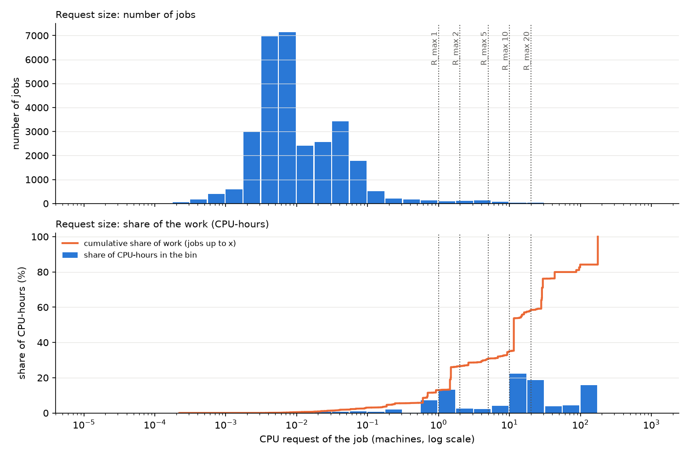

# Week 32, step 3: the two limits, the duration, the type volume

All numbers are in `limits_numbers.md`. They come from `scripts/week32/limits.py`, run on
`data/batch_v2_30k.csv` with `configs/regime_v2.yaml`. No model was run.

## 1. Summary

* **What we did.** We changed the duration of a job to its "effective" length: its real CPU-hours divided by its
  request. Then we tested two limits on the job size (R_max) and the duration (d_max).
* **What we found.** Almost all jobs are small, but a few large, long jobs carry most of the work. 98.4% of the jobs
  ask for at most 1 machine, but they hold only 13% of the CPU-hours.
* **The two rules clash.** The 25% rule gives a cluster of 0.2 to 3 machines. To make sure no job is larger than
  that, we must remove every job above 0.1 machine. Then we keep only **1.3% of the work**.
* **What you must decide.** Either the cluster may never be smaller than R_max, or we accept that most of the work
  can never fit (section 5, decision 1).

## 2. The rules we use now

**Unit.** Google divides every CPU and memory value by the capacity of the largest machine in the trace, so 1.0 is
that machine. Google does not publish its number of cores or its memory, so this unit has no direct physical
meaning. Simulation studies on the Google traces face the same problem: Di and Cappello (GloudSim: Google Trace based
Cloud Simulator with Virtual Machines, Argonne preprint ANL/MCS-P5017-0913) note that 'one has to speculate the
maximum resource capacity per host for simulation' and compare several assumed sizes. We follow the same approach: we
assume that the largest machine has 64 cores and 256 GB, and we use this only for bids and energy. Requests and
capacity stay in machines.

The rules:

1. **Jobs:** 30,000 jobs of cell a, chosen uniformly with a fixed hash. Only jobs that start and end inside the month.
2. **Request:** the SUM of the first request of each instance, in machines. We keep the **first** request of each
   instance. The "request changed" flag is not trusted: it is true for 100% of the jobs, which is too many to be
   real resizing.
3. **Duration:** the effective duration = real CPU-hours / request. The same duration is used for the time in the
   cluster, the bid and the energy.
4. **d_max:** durations longer than d_max are cut, not removed. The code allows d_max ≤ 0.05 × T. Here T = 414 to
   432 h (it depends on R_max), so 0.05 × T = 20.2 to 21.6 h.
5. **R_max:** jobs larger than R_max machines, in CPU or RAM, are removed.
6. **Cluster:** for each resource, the demand level exceeded 25% of the time when every job is admitted.
7. **Unchanged:** xi and gamma stay forced. There is no outlier filter. Hardware profiles are used only to build the
   type id.

## 3. Key figure

The top panel shows the number of jobs, the bottom panel the share of the work. Most jobs are tiny (left), but most
of the work is in jobs of 1 to 175 machines (right).

The duration figure is `figs/fig5_duration.png`. The demand over the month for the pair the rule picks is
`figs/fig6_demand_limits.png`.

## 4. Tables

**Table 1. Span duration versus effective duration** (30,000 jobs, no limit, no cap)

| duration | CPU-hours | RAM-hours |
|---|---|---|
| span (first start to last end) | 15,298 | 9,616 |
| **effective** (real CPU-hours / request) | **7,341** | **4,719** |
| real, each instance on its own time (reference) | 7,341 | 4,743 |

* The duration changes by more than 10% for 4,422 jobs (14.7%).
* Those jobs hold 71% of the work.
* The effective duration gives the real CPU-hours exactly, and RAM-hours within 0.5%.

**Table 2. The two limits, with d_max = 0.05 × T** (the cap that keeps the most work)

| R_max (machines) | work kept | cluster CPU / RAM (machines) | work in jobs larger than the cluster | first-come-first-served: work served |
|---|---|---|---|---|
| 0.1 (the rule's pick) | 1.3% | 0.17 / 0.10 | 0% | 70.9% |
| 1 | 3.8% | 0.47 / 0.29 | 41.3% | 49.1% |
| 5 | 9.5% | 1.08 / 0.75 | 59.0% | 35.0% |
| 20 | 21.9% | 1.92 / 0.99 | 77.0% | 17.6% |
| no limit | 63.9% | 3.07 / 1.89 | 89.9% | 8.9% |

* "Work kept" is the share of the CPU-hours of all 30,000 jobs that is left after the two limits.
* With d_max = 4 h or 12 h less work is kept, at every R_max (`limits_numbers.md`, table N2).

**Table 3. Option: the cluster is never smaller than R_max** (d_max = 0.05 × T)

| R_max = cluster (machines) | work kept | jobs larger than the cluster | first-come-first-served: work served | cores / GB (64 / 256 per machine) |
|---|---|---|---|---|
| 5 | 9.5% | 0 | 90.7% | 320 / 1,280 |
| 10 | 13.4% | 0 | 83.4% | 640 / 2,560 |
| 20 | 21.9% | 0 | 88.5% | 1,280 / 5,120 |

## 5. Open decisions

1. **The two rules clash.** My recommendation: the cluster = the larger of the 25% level and R_max, with
   R_max = 20 machines. No job is then too big, 21.9% of the work is kept, and 88.5% of that is served.
2. **d_max.** My recommendation: 0.05 × T (about 21 h), the largest the code allows. Jobs longer than 21.6 h still
   hold 43.5% of the work. Going above 0.05 × T would break the theory's d_max ≪ T.
3. **The Phase 0 type volume** (new switch `hardware.type_volume: real_mean`, default off; **this changes Phase 0
   and ReInit**). The mean real request of a type is close to its profile: the ratio is 1.005 at the median, 0.81 at
   the 10th percentile and 1.25 at the 90th. My recommendation: turn it on, so the LP and the gate use the same sizes.
4. **The effective duration changes Phase 0** (bids, energy, mean durations). The step-2 numbers in `data_v2.md` used
   the span. My recommendation: keep effective, as asked.
5. **Price file for 1–2 June.** It cannot be fetched (see below). My recommendation: download PJM "Day-Ahead Hourly
   LMPs", COMED zone, 1–2 June 2019, from PJM Data Miner 2, or give me a PJM API key.
6. **The GloudSim quote.** I found the paper: Di and Cappello, *Software: Practice and Experience* 45 (2015). I could
   not check the quote or the report number ANL/MCS-P5017-0913. My recommendation: check them in the PDF before the
   thesis.

**Why the price file was not extended (task 5).** The existing file comes from
`cloud_pricing_sim/scripts/extraction_grid_data.py`. It joins two sources:

* the PJM COMED day-ahead prices from a CSV downloaded by hand (`data/raw/pjm/comed_da_hrl_lmps.csv` →
  `lmps_hrl.csv`; no script does this step);
* the EIA carbon data from the EIA API (the key is in `.env`).

The PJM API returns HTTP 401 without a subscription key, so I stopped, as asked. The file is otherwise correct in
UTC. Its first 4 hours (00:00 to 03:00 UTC on 1 May) repeat the first real price.
