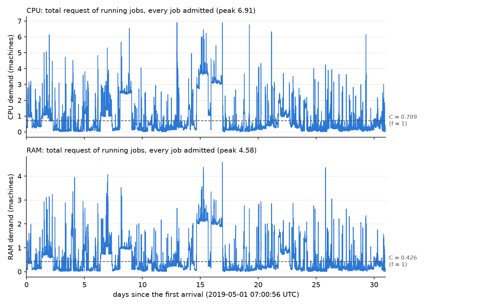

# Week 32: a new way to size the cluster (the v3 environment)

All other numbers are in `new_environment_numbers.md`.

* Script: `scripts/week32/new_environment.py`.
* Config: `configs/v3_mean_demand.yaml`.
* Phase 0 output: notebook `notebooks/01_phase0_diagnostics.ipynb`.

No online model was run. `configs/default.yaml` and the existing capacity modes are unchanged. With the default
config, the data path and Phase 0 give the same numbers as before, bit for bit (26 arrays checked on the real trace).

## 1. Summary

* **What we did.** We cut durations at 24 h and rejected the largest 1% of jobs (the quota). We sized the cluster
  from the mean demand in the history H, and ran Phase 0 on this environment.
* **The mean-demand rule works as designed.** In H the mean CPU demand is 0.709 machines. The simulated average
  matches it within 1.0%.
* **But big jobs still do not fit.** The quota lets in jobs of up to 3.9 machines, which is 5.5 times the cluster.
  The quota and the cap together leave 7.8% of all CPU-hours.
* **Phase 0 does not use the capacity.** The LP-RS keeps the cluster only 9% (CPU) and 12% (RAM) full, and τ = 0 on
  both resources. Only 67.5% of the types have a positive reward, and the carbon price is 7,638 $/kgCO₂.
* **What you must decide:** the quota level and the recalibration of the bid model (section 5).

## 2. The rules we use now (v3)

1. **Jobs:** the 30,000 jobs of `data/batch_v2_30k.csv`. There is no R_max in v3; the quota replaces it.
2. **Duration:** d_j = min(effective duration, 24 h). Jobs are kept, only shortened. The same d_j is used for the
   time in the cluster, the bid (hourly rate × d_j), the energy and the carbon. With the cap on, d_max = 24 h.
3. **Quota:** a job is rejected before the market if CPU > 3.931 machines or memory > 2.814 machines. These are the
   99th percentiles of the per-job request in H. 269 jobs (0.90%) are rejected; they never enter Phase 0 or the
   online run.
4. **Cluster size:** C = f × D̄, for each resource. D̄ is the total work of H (request × d_j, after the quota) divided
   by the time H spans: D̄ = 0.709 CPU and 0.426 memory machines.
5. **f = 1.00.** It was chosen by a rule fixed in advance: the share of time the demand is at least 95% of C should be
   closest to 25–50%, preferring about 35%. At f = 1.00 it is 33.2%.
6. **Prices for 1–3 June:** each missing hour is a copy of the same hour on 30 or 31 May, marked `is_filled`.
7. **Unchanged:** the additive dollar reward, the carbon map at q = 0.90, s_C frozen in Phase 0, the known bid
   distribution (σ = 0.3), and xi = 0.001 and gamma = 1.0 forced. u0, γ1, γ2 and s_C are **not** recalibrated yet.

## 3. Key figure

The demand over the month when every job is admitted, with C (dashed). The demand is spiky. It is at or above 95% of
C 33% of the time (CPU or memory), and its CPU peak is 9.7 times C.

The CDFs of request and duration are in `figs/fig7_cdf_request.png` and `figs/fig8_cdf_duration.png`.

## 4. Tables

**Table 1. The f scan** (whole month, every job that passes the quota, first-come-first-served, no prices)

| f | C CPU / memory (machines) | time with demand ≥ 95% of C | jobs accepted | CPU-hours served | largest job / C (CPU) |
|---|---|---|---|---|---|
| 0.10 | 0.071 / 0.043 | 93.8% | 53.9% | 5.6% | 55.4 |
| 0.25 | 0.177 / 0.107 | 72.7% | 81.6% | 12.9% | 22.2 |
| 0.50 | 0.354 / 0.213 | 50.9% | 92.5% | 20.9% | 11.1 |
| 0.75 | 0.532 / 0.320 | 39.1% | 95.9% | 26.9% | 7.4 |
| **1.00** | **0.709 / 0.426** | **33.2%** | **97.8%** | **29.1%** | **5.5** |

"Time with demand ≥ 95% of C" counts CPU or memory. Under the 64 / 256 assumption, C at f = 1.00 is 45 cores and
109 GB.

**Table 2. What the cap and the quota remove** (all 30,000 jobs)

| step | jobs | share of jobs | share of all CPU-hours |
|---|---|---|---|
| 24 h cap (shortened, kept) | 92 | 0.31% | 35.3% lost |
| quota (rejected) | 269 | 0.90% | 71.5% |
| left after both | 29,731 | 99.1% | 7.8% |

**Table 3. Phase 0 on v3** (current u0, γ1, γ2; no recalibration)

| what | value |
|---|---|
| types: all / with jobs in H | 20,480 / 3,020 (128 bid bins × 5 priorities × 32 profiles) |
| arrival rate | 31.7 jobs per hour (median type: 0.003 per hour) |
| τ (CPU, memory) | 0, 0 |
| types the LP admits | 2,040, all fully |
| how full the LP keeps the cluster | 9.0% CPU, 12.0% memory |
| types with a positive reward | 67.5% of types, 81.3% of the arrival mass (target 90%; old data 74%) |
| reward split, all types ($ / h) | customer value +1,589, profit +178, carbon −2,624 |
| reward split, admitted types ($ / h) | customer value +1,340, profit +209, carbon −270 |
| carbon price s_C | 7,638 $ / kgCO₂ |

## 5. Open decisions

1. **The quota is far above the cluster.** The largest admitted job is 5.5× C (flag: > 0.2). My recommendation: set
   the quota at a share of C (for example 0.2 × C) instead of the 99th percentile, and report how much work that
   keeps.
2. **The LP leaves 88–91% of the cluster empty (τ = 0).** The positive-reward types are small, and C equals the mean
   demand of all types, including the negative ones. My recommendation: recalibrate the bid model first (decision 3),
   then look at f again with the same fixed rule.
3. **The carbon price is out of scale** (7,638 $/kgCO₂). It comes from the quantile map on the new types.
   My recommendation: recalibrate u0 (and re-check γ1, γ2) on v3, then recompute s_C. Do not tune s_C by hand.
4. **38.3% of jobs are shorter than 1 minute.** The 1-minute floor lifts them, but this adds only 0.02% of the
   CPU-hours. My recommendation: keep the floor and state it.
5. **Filled price hours.** 242 jobs (0.81%) run partly in filled hours. The model prices a job at its arrival hour,
   so only the 232 jobs that arrive in filled hours use a filled price: 0.15% of the energy cost. My recommendation:
   keep the fill, but replace it with real PJM data if a download becomes possible.

### Where the code differs from the request (the code wins)

* **The job count.** The file has **30,000** jobs, not 29,670 (that was the old biased sample). All distributions
  use the 30,000.
* **R_max.** "v3 = default.yaml + …" would also bring the default's R_max = 0.1 machine, which would make the quota
  meaningless. I set `r_max_machines: null` in v3.
* **d_max.** With the cap on, d_max = 24 h and the 0.05 × T ceiling (21.4 h here) is not applied. The online model
  needs d_max ≥ the longest duration. The abort check still holds: 24 h / 428.8 h = 0.056 < 0.10.
* **Where C is computed.** It is computed in `load_dataset`, before Phase 0, from H only (jobs after the quota,
  capped durations, H's span of 315.1 h). It uses exactly the information Phase 0 has.
* **Which H the quota uses.** The quota values were computed on the first 10,000 jobs before the quota. After the
  quota, H is the first 10,000 **kept** jobs, which ends slightly later (315.1 h instead of 312.4 h).
* **gamma on the data is 86,400**, because d_max in seconds enters it. It stays forced at 1.0, so nothing changes.
