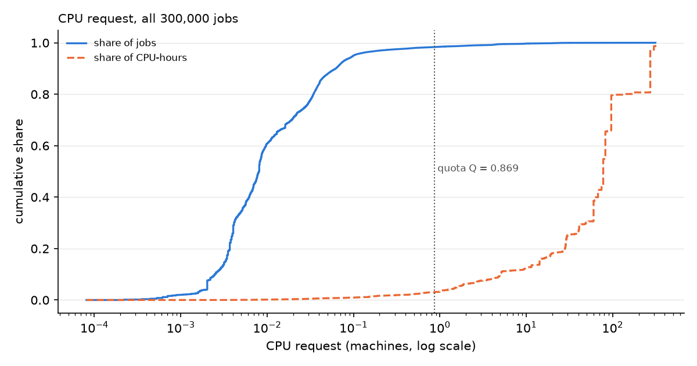
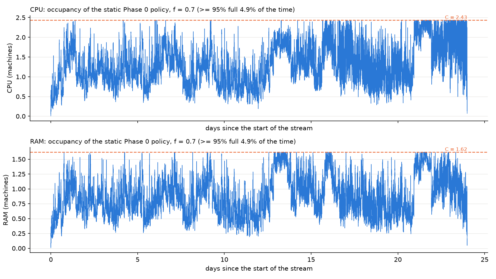

# Week 32: job distributions and the theoretical models over f

* Raw numbers: `theory_models_numbers.md`, from `scripts/week32/theory_models.py`.
* Logic: `dlent_rt/theory_eval.py`.
* Notebook: `notebooks/05_theory_models.ipynb` (runs top to bottom).
* Config: `configs/v5_theory.yaml`.

No online model (DLENT-RT) and no job-level model was run. `configs/default.yaml`, the bid and the carbon map are
unchanged. The default config gives the same numbers as before, and its snapshots do not change.

## 1. What we ran

* **Job distributions** of all 300k jobs and of the jobs of H (the first 7 days), before and after the 24 h cap and
  the quota.
* **A new option, `limits.quota_from_f`.** It computes the quota fixed point at one f (here 1.25) while C uses the
  scanned f. So every f sees **the same jobs**: Q = 0.869 CPU / 0.578 RAM machines, 46,596 jobs in H and 248,185
  in the stream (T = 576 h). There is a unit test.
* **For f = 0.10, 0.20, 0.30, 0.50, 0.70 and 1.25:**
  * three LPs: the Phase 0 LP, fluid OPT, and fluid on feasible types;
  * the static Phase 0 policy on the real stream;
  * the fluid LP on each 1-day and 6-hour window.

## 2. Job distributions

**What the cap and the quota remove** (shares of the effective CPU-hours):

| set | jobs | cut by the 24 h cap | CPU-hours cut | removed by the quota | CPU-hours removed | CPU-hours left after both |
|---|---|---|---|---|---|---|
| all 300k | 300,000 | 901 (0.30%) | 65.9% | 5,219 (1.74%) | 97.1% | **1.3%** |
| H (first 7 days) | 47,909 | 247 (0.52%) | 46.1% | 1,313 (2.74%) | 84.8% | **3.6%** |

The full percentile tables are in `theory_models_numbers.md`, table N1: by jobs and weighted by CPU-hours, for CPU,
RAM, duration before and after the cap, and r·d.

* **The quota.** 98% of the jobs ask for less than Q = 0.87 machine, but those jobs hold only about 3% of the
  CPU-hours (figure above). Almost all the work is in the 2% of jobs above Q, up to 313 machines. The RAM picture is
  the same (`figs/fig13_cdf_ram.png`).
* **The 24 h cap.** It touches only 0.3% of the jobs, but those jobs hold two thirds of the CPU-hours
  (`figs/fig14_cdf_duration.png`).
* **Size and duration together.** The 2D histogram (`figs/fig15_hist2d_cpu_duration.png`) shows most jobs at
  0.001–0.1 machine and under 1 minute to 1 hour. The work sits in a thin corner: large and long.
* **H represents the month for the typical job.** The CDFs of request and duration for H and for the whole month
  overlap (`figs/fig16_H_vs_month.png`). The rare large jobs are the exception (section 6).
* **What this means.** The cap and the quota are both reasonable for the *typical* job. Together, though, they leave
  only 1.3% of the month's work. The model studies the many small jobs, not the few that carry the work.

## 3. Which models are theoretical (from the code)

| model | code | what it is |
|---|---|---|
| fluid OPT | `benchmarks.py:124` `reference_state`, `:132` `fluid_opt` | the LP on the type rates and means of the whole stream (hindsight, true durations, no fallback), × T |
| fluid on feasible types | `benchmarks.py:196` `fluid_opt_feasible_types` | the same LP, with the types whose request is larger than C removed |
| bucketed MILP | `benchmarks.py:147` `bucket_types`, `:163` `job_opt_bucketed` | a per-job MILP where each job earns its type's reward |
| static Phase 0 | `models/policy.py:70` `StaticPolicy` | the frozen Phase 0 state |

**Where the code differs from your description:**
* **The static policy is all-or-nothing.** `StaticPolicy` admits a type fully when r̃ − τ·v > 0 (line 79). It does
  not thin by the LP fraction. For thinning by the fraction, I added `FractionPolicy` (`models/policy.py:193`): it
  admits each arrival with probability x of its Phase 0 type, with seed 42 and the real capacity gate. It is used
  in section 5.
* **Fluid OPT uses the stream (the 24 days after H), not the whole month.**
* **The bucketed MILP was not run.** It would have 220,287 candidate jobs and 42 million constraint nonzeros, too
  big to run, so I skipped it as allowed. The discretization cost is therefore not available.

## 4. Results by f

**Cluster size** (the same jobs for every f)

| f | C CPU / RAM (machines) | C cores / GB (64 / 256 per machine) | stream load / C | jobs larger than C (stream) |
|---|---|---|---|---|
| 0.10 | 0.35 / 0.23 | 22 / 59 | 9.3 | 1,850 (30.8% of the CPU-hours) |
| 0.20 | 0.69 / 0.46 | 44 / 118 | 4.6 | 295 (6.7%) |
| 0.30 | 1.04 / 0.69 | 67 / 178 | 3.1 | 0 |
| 0.50 | 1.74 / 1.16 | 111 / 296 | 1.9 | 0 |
| 0.70 | 2.43 / 1.62 | 156 / 414 | 1.3 | 0 |
| 1.25 | 4.34 / 2.89 | 278 / 740 | 0.74 | 0 |

**τ, types admitted, and how full each LP keeps the cluster.** CPU / RAM; types are fully / partly / rejected.

| f | Phase 0 LP: τ | types | fill | fluid OPT: τ | types | fill |
|---|---|---|---|---|---|---|
| 0.10 | 0.0045 / 0.0054 | 176 / 2 / 3,827 | 100% / 100% | 0.0042 / 0.0038 | 362 / 2 / 5,189 | 100% / 100% |
| 0.20 | 0.0038 / 0.0036 | 467 / 2 / 3,536 | 100% / 100% | 0.0036 / 0.0031 | 648 / 2 / 4,903 | 100% / 100% |
| 0.30 | 0.0032 / 0.0030 | 779 / 2 / 3,224 | 100% / 100% | 0.0030 / 0.0028 | 982 / 2 / 4,569 | 100% / 100% |
| 0.50 | 0.0021 / 0.0016 | 1,473 / 2 / 2,530 | 100% / 100% | 0.0021 / 0.0017 | 1,871 / 2 / 3,680 | 100% / 100% |
| 0.70 | 0.0014 / 0.000003 | 2,147 / 2 / 1,856 | 100% / 100% | 0 / 0.0009 | 3,104 / 1 / 2,448 | 99% / 100% |
| 1.25 | 0 / 0 | 2,670 / 0 / 1,335 | 66% / 65% | 0 / 0 | 3,543 / 0 / 2,010 | 60% / 61% |

Fluid on feasible types equals fluid OPT for f ≥ 0.30. For f = 0.10 and 0.20 it removes 175 and 17 types; its τ is in
table N4.

**Reward per model, over the stream ($)**

| f | fluid OPT | fluid feasible | Phase 0 LP (expected) | static Phase 0 (realised) | static / fluid OPT |
|---|---|---|---|---|---|
| 0.10 | 6,368 | 5,713 | 6,941 | 1,108 | 17% |
| 0.20 | 10,727 | 10,427 | 12,288 | 3,250 | 30% |
| 0.30 | 14,502 | 14,502 | 16,316 | 5,636 | 39% |
| 0.50 | 20,346 | 20,346 | 22,204 | 10,105 | 50% |
| 0.70 | 22,901 | 22,901 | 25,482 | 11,971 | 52% |
| 1.25 | 23,023 | 23,023 | 26,249 | 13,592 | 59% |

* **The split is about the same at every f.** For fluid OPT at f = 0.30: customer value 18,380, profit 3,154, carbon
  −7,033 (table N5).
* **The gap from static Phase 0 to fluid OPT** ranges from $5,260 (f = 0.10) to $10,931 (f = 0.70).
* **The discretization cost is not available,** because the MILP was skipped.

## 5. Occupancy and τ over time

**(a) The static Phase 0 policy on the real stream** (fraction thinning, seed 42, real capacity)

| f | time ≥ 95% full (CPU or RAM) | mean occupancy / C (CPU) | jobs rejected for lack of space | realised reward $ |
|---|---|---|---|---|
| 0.10 | 1.4% | 29% | 0.09% | 1,108 |
| 0.20 | 1.4% | 40% | 0.48% | 3,250 |
| 0.30 | 4.0% | 49% | 0.89% | 5,636 |
| 0.50 | 4.8% | 55% | 1.18% | 10,105 |
| 0.70 | 4.9% | 53% | 1.06% | 11,971 |
| 1.25 | 0.5% | 37% | 0.09% | 13,592 |

**Selection rule (fixed in advance, report only):** "time ≥ 95% full" closest to 20–30%, preferring 25%. **It picks
f = 0.70, but only at 4.9%: no f reaches the band.** Nothing was set in a config.

**(b) τ of the fluid LP per window** (each window with its own type rates)

| f | windows with τ > 0, 1 day (CPU / RAM) | windows with τ > 0, 6 h (CPU / RAM) | τ per day, CPU: p50 / p90 / max |
|---|---|---|---|
| 0.10 | 100% / 100% | 100% / 100% | 0.0047 / 0.0071 / 0.0129 |
| 0.20 | 100% / 100% | 94% / 94% | 0.0036 / 0.0055 / 0.0074 |
| 0.30 | 91% / 96% | 81% / 79% | 0.0028 / 0.0043 / 0.0056 |
| 0.50 | 74% / 83% | 51% / 51% | 0.0010 / 0.0030 / 0.0038 |
| 0.70 | 39% / 52% | 27% / 34% | 0 / 0.0016 / 0.0037 |
| 1.25 | 0% / 0% | 4% / 12% | 0 / 0 / 0 |

The τ per day for f = 0.70 is in `figs/fig20_tau_per_day_selected.png`; τ against f is in `figs/fig17_tau_vs_f.png`.

**Jobs larger than C, and how each model treats them** (f = 0.10: 1,850 stream jobs; f = 0.20: 295; none above):
* **Fluid OPT** may admit their types, because it only counts average volume.
* **Fluid on feasible types** removes those types.
* **The static policy** never admits them: its own LP rejects those types, and the capacity gate would block them
  anyway (0 such jobs wanted).
* **The bucketed MILP** could not choose them (not run).

## 6. Are the results consistent?

* **Fluid OPT ≥ fluid on feasible types:** yes, at every f. They are equal for f ≥ 0.30, where no job is larger
  than C.
* **Fluid on feasible types ≥ bucketed MILP:** not checked (MILP skipped).
* **Reward falls as f falls:** yes, for every model.
* **τ rises as f falls:** yes, for the Phase 0 LP and for fluid OPT. τ = 0 at f = 1.25. At f = 0.70 τ is close to 0,
  and the windows bind about half the time.

**Things that look odd:**

1. **The Phase 0 LP expects more than fluid OPT, by 9–15%.** It is learned on H's rates and means, and applied to
   the stream's T. Why H looks better than the stream is not measured yet (open issue 5).
2. **The static Phase 0 policy realises only 17–59% of fluid OPT, and never fills the cluster.** Its mean occupancy is
   29–55% of C, while its own LP expects 100%. **The main cause:** 2.0% of the stream's jobs fall in types never seen
   in H. They get x = 0, but they hold **41.8% of the stream's CPU-hours**. These are the rare large and long types:
   7 days of history do not contain them. The randomness of thinning adds smaller gaps.
3. **So the occupancy rule "20–30% of the time ≥ 95% full" cannot be met** with this policy at any f. It is closest at
   f = 0.70 (4.9%).
4. **At f = 0.70 the Phase 0 LP gives τ_RAM = 0.000003,** which is effectively 0: the LP is at the edge of binding on
   RAM.

## 7. Open issues

1. **The cap and the quota leave 1.3% of the month's CPU-hours.** The environment is the many small jobs. Decide
   whether that is the intended scope.
2. **The static policy loses 42% of the work to types unseen in H.** A longer H, coarser types (fewer hardware
   profiles or bid bins), or a fallback for unseen types (as ReInit has) would change this. That is a model decision.
3. **No f meets the occupancy rule.** Revisit the target band, or measure fullness differently (for example the mean
   occupancy / C).
4. **The bucketed MILP is too big at 248k jobs.** It needs a smaller stream (for example one week), or a
   decomposition by window, to give the discretization cost.
5. **The Phase 0 LP is optimistic against fluid OPT** (H against the stream). Check how the per-type means differ.
