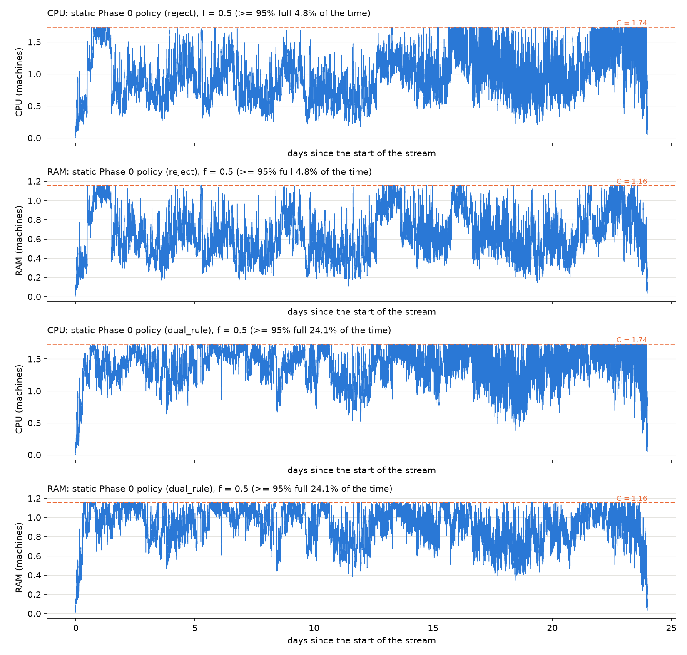

# Week 32: unseen types, H vs stream, and the bucketed MILP on one week

* Raw numbers: `theory_models_2_numbers.md`, from `scripts/week32/theory_models_2.py`.
* Logic: `dlent_rt/theory_eval.py`.
* Notebook: `notebooks/05_theory_models.ipynb`, section 4. It reads the script's cache, because the MILPs take
  about 1 hour.
* Config: `configs/v5_theory.yaml`.

Only type / average models were run: no online model and no job-level model. The default config, the bid and the
carbon map are unchanged. With the default config the numbers are the same as before, and the snapshots do not
change. The fast suite passes: 95 passed.

## 1. What we ran

* **A new option, `policy.unseen_types`:** "reject" (the default, today's behaviour) or "dual_rule". The static Phase 0
  policy was run on the real stream with both options, for f = 0.10 to 1.25.
* **H against the stream,** type by type on Phase 0's grid, and why the Phase 0 LP is optimistic.
* **Fluid OPT, fluid on feasible types and the bucketed MILP** on the first 7 days of the stream (days 8–14 of the
  month) for f = 0.30, 0.50 and 0.70, plus a 1-day check.

## 2. Unseen types: the fix and its effect

**The code does not support the premise.** For a type with no job in H, r̃ and v cannot be computed from the known
bid distribution and the type alone:

* The type is (bid bin, priority, hardware profile) (`phase0.py:130`). Duration, scheduling class and the cost base
  are not part of it.
* Every per-type statistic is a sample mean over H's jobs (`phase0.py:265-271`). For a type with no jobs,
  `type_mean` returns 0 (`reward.py:86-90`). So an unseen type gets d̄ = v̄ = φ̄ = 0, so r̃ = 0 and
  v = A_type × d̄ = 0 (`phase0.py:337-338`).

**What I did instead (my design choice, please confirm).** `theory_eval.unseen_type_estimates` fills the unseen
types with estimates from H:

* duration, energy, electricity and carbon: the mean over H's jobs with the same hardware profile. This is ReInit's
  "last resort" rule (`reinit.py:113-127`);
* bid and φ: the mean over H's jobs in the same bid bin;
* request: the hardware profile;
* carbon price: Phase 0's s_C.

With "dual_rule", an arrival of an unseen type is admitted if r̃_u − τ·v_u > 0 (Phase 0's τ), subject to the capacity
gate. Seen types keep the fraction policy. Unit tests: `tests/test_unseen_types.py`.

**Effect.** Static Phase 0 policy, real stream, seed 42. 2.0% of the stream's jobs are in unseen types; they hold
41.8% of its CPU-hours.

| f | option | time ≥ 95% full | mean occupancy / C (CPU) | jobs rejected for lack of space | unseen-type jobs admitted | realised reward $ | static / fluid OPT |
|---|---|---|---|---|---|---|---|
| 0.10 | reject | 1.4% | 29% | 0.09% | 0 | 1,108 | 17% |
| 0.10 | dual rule | 26.0% | 80% | 1.47% | 1,410 | 1,995 | 31% |
| 0.20 | reject | 1.4% | 40% | 0.48% | 0 | 3,250 | 30% |
| 0.20 | dual rule | 28.0% | 79% | 4.03% | 1,686 | 4,204 | 39% |
| 0.30 | reject | 4.0% | 49% | 0.89% | 0 | 5,636 | 39% |
| 0.30 | dual rule | 25.9% | 81% | 4.38% | 1,871 | 7,223 | 50% |
| 0.50 | reject | 4.8% | 55% | 1.18% | 0 | 10,105 | 50% |
| 0.50 | dual rule | **24.1%** | 79% | 4.97% | 2,092 | 11,017 | 54% |
| 0.70 | reject | 4.9% | 53% | 1.06% | 0 | 11,971 | 52% |
| 0.70 | dual rule | 16.3% | 76% | 3.21% | 2,395 | 14,128 | 62% |
| 1.25 | reject | 0.5% | 37% | 0.09% | 0 | 13,592 | 59% |
| 1.25 | dual rule | 5.0% | 60% | 0.69% | 2,630 | 18,075 | 79% |

* **The dual rule admits only about 2,000 more jobs, but they are large.** The mean occupancy rises from 29–55% to
  60–81% of C.
* **The realised reward rises at every f,** by +9% (f = 0.5) to +80% (f = 0.1).
* **More jobs are turned away for lack of space** (up to 5%), because the cluster is now often full.

## 3. Selected f

The same fixed rule as before: "time ≥ 95% full" closest to 20–30%, preferring 25%.

| option | f picked | time ≥ 95% full |
|---|---|---|
| reject | 0.70 | 4.9% (no f reaches the band) |
| **dual rule** | **0.50** | **24.1% (inside the band)** |

Nothing was set in a config.

## 4. H against the stream

On Phase 0's grid:
* **Types:** 4,005 have jobs in H, 5,558 in the stream, and 3,724 in both.
* **For types in both** (weighted by H's rate), stream / H is 1.53 for the arrival rate, 1.03 for the mean r·d, and
  **0.62 for r̃**.
* **CPU load** (rate × mean r·d): **H 3.47 machines, stream 3.22, of which 1.35 in types never seen in H.**

**The 10 types whose load differs most** (all in bid bins 114–128, the highest bids, mostly hardware profile 2):

| type (bin, priority, profile) | rate H /h | rate stream /h | mean r·d H | mean r·d stream | load H | load stream |
|---|---|---|---|---|---|---|
| 128, 4, 2 | 0.0119 | 0.0017 | 15.6 | 16.7 | 0.186 | 0.029 |
| 120, 2, 2 | 0.0119 | 0.0052 | 12.5 | 9.7 | 0.149 | 0.050 |
| 116, 4, 15 | 0.0238 | 0.0017 | 3.8 | 2.2 | 0.090 | 0.004 |
| 118, 4, 16 | 0.0179 | 0.0069 | 6.0 | 4.1 | 0.108 | 0.029 |
| 123, 4, 2 | 0.0060 | 0.0017 | 15.4 | 11.3 | 0.092 | 0.020 |
| 124, 2, 2 | 0.0060 | 0.0017 | 15.4 | 13.0 | 0.091 | 0.023 |
| 124, 4, 2 | 0.0060 | 0.0052 | 15.9 | 10.3 | 0.095 | 0.054 |
| 121, 4, 2 | 0.0060 | 0.0017 | 9.0 | 8.2 | 0.054 | 0.014 |
| 118, 4, 2 | 0.0060 | 0.0017 | 6.9 | 5.1 | 0.041 | 0.009 |
| 114, 4, 15 | 0.0119 | 0.0035 | 3.4 | 2.6 | 0.040 | 0.009 |

**Why the Phase 0 LP expects 9–15% more than fluid OPT.** Take f = 0.50:

| step | $ |
|---|---|
| Phase 0 LP (H's statistics) | 22,204 |
| the LP on the stream's statistics, Phase 0's grid | 20,380 (−8.2%) |
| fluid OPT (the grid refit on the stream) | 20,346 (−0.2%) |

So the gap comes from H's statistics, not from the grid. H holds several large, high-bid types much more often than
the rest of the month does: their load falls from 0.19 to 0.03 machines. Over the types seen in both, the type
reward in the stream is only 0.62 of H's. The LP plans on H's richer mix and so over-promises. (Phase 0's own x,
valued on the stream's statistics, gives $10,446, close to the realised $10,105 of the "reject" static policy.)

## 5. Discretization cost on one week

The first 7 days of the stream (59,985 jobs), reference buckets, true durations. The MILP has 53,214 candidates and
9.3 million constraint nonzeros. Its limit is 900 s; each f ran in its own process (see issue 1).

| f | fluid OPT $ | fluid on feasible types $ | bucketed MILP, best solution $ | its LP bound $ | gap | discretization cost $ (and %) |
|---|---|---|---|---|---|---|
| 0.30 | 4,491 | 4,491 | 3,620 | 4,226 | 15.7% | between 265 and 871 (5.9–19.4%) |
| 0.50 | 6,176 | 6,176 | 5,272 | 5,660 | 7.0% | between 516 and 904 (8.4–14.6%) |
| 0.70 | 6,868 | 6,868 | 6,353 | 6,413 | 0.6% | between 455 and 514 (6.6–7.5%) |

* **The MILP did not reach optimality in time, so the cost is a range.** The low end uses the MILP's LP bound; the
  high end uses its best solution.
* **An earlier single run at f = 0.50,** which had the full 900 s, found $5,572 (gap 1.2%). That narrows f = 0.50 to
  $516–604 (8.4–9.8%).
* **The LP runtime is under a second.** The MILPs ran about 560 s each.

**One day (days 0–1 of the stream) is not usable.** There the MILP scores more than fluid OPT, for example $1,096
against $916 at f = 0.30. The MILP checks capacity only at arrival times inside the window. A job admitted near the
end runs past the window, and nothing limits it there. Fluid charges its full average volume. With durations up to
24 h, this end-of-window effect is large on one day and small on one week. It also makes the one-week costs above
slightly too low.

## 6. Consistency checks

* **Fluid OPT ≥ fluid on feasible types ≥ bucketed MILP:** yes on one week, at all three f. Fluid OPT equals fluid on
  feasible types there, because no job is larger than C at f ≥ 0.3. It fails on one day, because of the
  end-of-window effect (section 5).
* **Reward rises with f:** yes, for both static options and for all three models on the week.
* **The static policy realises less than fluid OPT at every f:** yes (17–79%).
* **The dual rule raises reward and occupancy at every f:** yes. It also raises the rejections for lack of space,
  as expected.
* **The Phase 0 LP is optimistic because of H's statistics, not the grid:** confirmed by the decomposition.

## 7. Open issues

1. **The MILP time limit is shared within one Python process.** Run one after another in one process, the three
   one-week MILPs stopped at 624, 170 and 95 s, together about the 900 s limit. In their own processes they still
   stopped at about 560 s, apparently because the LP relaxation solved just before also counts. This affects every
   caller of `benchmarks.occupancy_milp` that solves several problems in one process. Not fixed: decide whether to
   run each MILP in its own process, or set the limit some other way.
2. **The dual rule relies on my fallback estimates** (hardware-profile and bid-bin means from H). Please confirm or
   replace them.
3. **H (7 days) over-represents a few large, high-bid types,** and misses types that hold 42% of the stream's
   CPU-hours. A longer H, or coarser types, would reduce both effects.
4. **The discretization cost is only bounded** (about 6–19% on one week). Solving it exactly needs more MILP time or
   a decomposition. The end-of-window effect should be handled too, for example by counting only the jobs that end
   inside the window, or by adding capacity checks after the last arrival.
