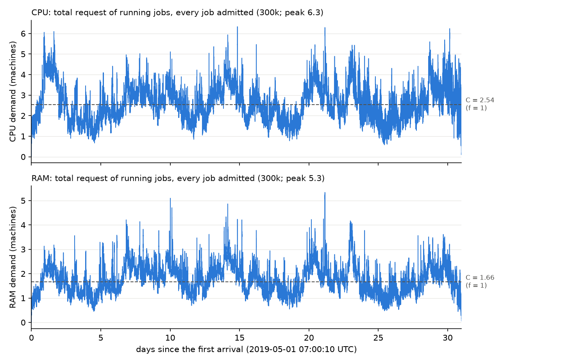

# Week 32: s_C, the uniform 300k sample, quota = 0.2 × C, Phase 0 on v4

Raw numbers: `v4_300k_numbers.md`. Script: `scripts/week32/v4_300k.py`. Config: `configs/v4_300k.yaml`. Phase 0:
`notebooks/01_phase0_diagnostics.ipynb` (run on v4). No online model was run. u0, γ1 and γ2 are unchanged.
`configs/default.yaml` is unchanged.

## 1. What changed and why

| what | why |
|---|---|
| **No s_C fix.** The units are correct; s_C is a property of the map. | Section 2. |
| **Priority fix (a data bug).** A job's priority and scheduling class now come from `collection_events`. | The old fetch used `ANY_VALUE` over `instance_events`, which gives an arbitrary value. `instance_events` often holds priority 0 for jobs whose real priority is, for example, 200. |
| The 30k file was rebuilt with the fixed priorities. | 18.6% of its jobs had a wrong priority. **This changes Phase 0 under the default config (bug fix, not design).** |
| New file `data/batch_v2_300k.csv`: a uniform 300k sample. | More jobs per type; it contains the 30k sample. |
| New quota rule: Q = 0.2 × C (`limits.job_quota_rule: share_of_C`). | Ties the largest job to the cluster. |
| H can be set in days (`data.h_days`). | H = the first 7 days in v4. |
| New config `configs/v4_300k.yaml`. | v3 + 300k + quota 0.2 × C + H 7 days + f from the scan. |

## 2. s_C: cause, fix, before and after

**There is no unit bug, so there is no fix.** As agreed, I stopped and explain it with numbers.

* **The units are right.** Power is in kW, with PUE 1.10. Energy is kW × hours (the duration is in hours, not
  seconds). Carbon intensity is in kgCO₂/kWh (0.33 to 0.48), so carbon is in kg. The 86,400 is d_max in seconds; it
  enters gamma only, not s_C. A new test, `tests/test_units.py`, checks these units on a hand-made job.
* **A worked example** (the median job of H on v3):
  * request 0.0089 CPU / 0.0046 RAM machines, duration 1.1 minutes;
  * power 0.0109 kW, energy 0.00020 kWh, carbon 0.000085 kg;
  * bid $0.87, customer value $3.50, electricity cost $0.0000046;
  * carbon cost $0.65 at s_C = 7,638 $/kg, against $0.000016 at 0.19 $/kg.
* **Why s_C is so large.** The map sets s_C = D_q / K_q:
  * D_q = (90th percentile of customer value + 90th percentile of |profit|) / 2 = (44.27 + 9.77) / 2 = $27.0;
  * K_q = the 90th percentile of carbon per type = 0.0035 kg;
  * so s_C = 27.0 / 0.0035 = 7,638 $/kg.
* **The cause is the bid model.** Customer value comes mostly from the base utility u0 = 23.9 $/hour per job, for
  every job whatever its size. Carbon grows with the job's size. Our jobs are tiny (median 0.008 machine), so the
  dollars are large and the kilograms small.
* **It is not the 1-minute floor.** Without the floored jobs, K_q is 0.014 kg; the ratio is still near 2,000 $/kg.
* **Before and after.** s_C = 7,638 (v3, old priorities), 10,743 (v3, fixed priorities), 14,342 (v4).

## 3. The 300k sample

**How it was built.** We used the same SQL as the 30k sample, with LIMIT 300,000 instead of 30,000. It is the
300,000 eligible jobs with the smallest hash, so it contains the 30k sample.

* The project's free BigQuery storage (10 GB) was full, so a fresh run failed (billed 0).
* I reused the temporary tables of yesterday's 30k run instead. They are the same scans of the same unchanging
  tables. I deleted only our own expiring cache tables (0.9 GB) to make room.
* Billed: 9.6 GB for the sample. The priority fix then cost 0.8 GB, plus a 96 GB probe that was discarded.

**Check table**

| check | result | value |
|---|---|---|
| single-instance share vs the eligible cell | PASS | 79.5% vs 79.5% |
| priority-tier mix vs the 30k sample (the cell's priorities were not fetched) | PASS | largest gap 0.2 points |
| arrivals per hour vs the cell × the sample rate (5.85%) | PASS | correlation 0.993; 403 jobs per hour on both |
| the 30k jobs inside the 300k, identical rows | PASS | 30,000 of 30,000; integers and text equal; floats differ by at most 2e-14 (sums in another order) |
| SUM of first requests = real peak for ≥ 99% of jobs | PASS | 99.53% |
| effective duration: finite, ≥ 0, ≤ span, no NaN | PASS | |
| time base UTC, first arrival 1 May 07:00 | PASS | 07:00:10 UTC |
| no border jobs | PASS | |
| distributions close to the 30k | PASS | each 30k percentile (p50 to p99) lies inside the usual range of 30k-sized subsamples of the 300k (20 of 20) |

At first, two checks failed:
* "Identical rows" failed and showed the priority bug. 890 of the 30k jobs had different priorities in the two
  files. I fixed the fetch and rebuilt both files.
* The distribution check failed against a fixed 15% gap at p99, where the 30k sample has only about 300 jobs. I
  replaced it with the subsample test above.

## 4. Quota = 0.2 × C: iterations and final values

Start from Q = the 99th percentile of H. Then repeat: remove the jobs above Q, compute D̄ on H, C = f × D̄, and
Q = 0.2 × C. Stop when Q moves less than 1% on both resources. Shown for H = 7 days and f = 1.0 (CPU / RAM, machines):

| step | Q | D̄ | next Q | change |
|---|---|---|---|---|
| 0 | 4.137 / 2.838 | 11.20 / 7.41 | 2.240 / 1.482 | 46% / 48% |
| 1 | 2.240 / 1.482 | 6.98 / 4.67 | 1.395 / 0.934 | 38% / 37% |
| 2 | 1.395 / 0.934 | 4.46 / 3.02 | 0.893 / 0.604 | 36% / 35% |
| 3 | 0.893 / 0.604 | 3.48 / 2.32 | 0.696 / 0.464 | 22% / 23% |
| 4 | 0.696 / 0.464 | 3.14 / 2.05 | 0.628 / 0.411 | 10% / 11% |
| 5 | 0.628 / 0.411 | 2.67 / 1.75 | 0.533 / 0.350 | 15% / 15% |
| 6 | 0.533 / 0.350 | 2.56 / 1.67 | 0.512 / 0.334 | 4.0% / 4.7% |
| 7 | 0.512 / 0.334 | 2.54 / 1.66 | **0.509 / 0.332** | 0.5% / 0.5% |

**Final values.** Q = 0.509 CPU and 0.332 RAM machines; C = 2.54 / 1.66 machines; Q / C = 0.200. The quota rejects
6,531 of the 300,000 jobs (2.2%), but **those jobs hold 97% of the CPU-hours**.

## 5. Choice of H

At f = 1.0. "Week" means a 7-day block from the first arrival.

| H | jobs | D̄ of H, CPU / RAM | D̄ of the month, CPU / RAM | H vs month | weekly D̄ (CPU), weeks 1–5 |
|---|---|---|---|---|---|
| first 10% of jobs (4.6 days) | 30,000 | 2.48 / 1.49 | 2.47 / 1.65 | +0.5% / −10.1% | 2.46, 2.53, 2.42, 2.32, 2.82 |
| **first 7 days** | 46,205 | 2.54 / 1.66 | 2.56 / 1.72 | −0.8% / −3.8% | 2.54, 2.75, 2.44, 2.38, 2.90 |

**Recommendation: H = 7 days.** It is closest to the month on both resources. The weeks differ from the month by −7% to
+13% (CPU), so one week is a fair sample. The config uses 7 days.

## 6. f scan and chosen f

The whole month, every job that passes the quota, first come first served, no prices. Each f has its own quota
fixed point.

| f | C CPU / RAM | Q CPU / RAM | time with demand ≥ 95% of C | jobs accepted | CPU-hours served | largest job / C | work kept by the quota |
|---|---|---|---|---|---|---|---|
| 0.10 | **collapses** | Q → 0 | – | – | – | – | – |
| 0.25 | 0.20 / 0.13 | 0.041 / 0.025 | 100.0% | 39.8% | 21.6% | 0.20 | 1.0% |
| 0.50 | 0.63 / 0.43 | 0.125 / 0.085 | 99.7% | 65.0% | 41.0% | 0.20 | 1.6% |
| 0.75 | 1.66 / 1.08 | 0.332 / 0.217 | 87.1% | 88.8% | 63.4% | 0.20 | 2.5% |
| **1.00** | **2.54 / 1.66** | **0.509 / 0.332** | **60.4%** | **95.6%** | **75.2%** | **0.20** | **3.0%** |

**The rule picks f = 1.00, but it is still outside the 25–50% band.** No f in the scan reaches the band. "Work kept
by the quota" is the share of all CPU-hours (capped durations) left after the quota.

## 7. Phase 0 on v4 (and on v3)

| | v4 (300k) | v3 (30k), fixed priorities | v3, before (last report) |
|---|---|---|---|
| types with jobs in H (of 20,480) | 5,845 | 2,724 | 3,020 |
| arrival rate | 275 jobs/hour | 32 jobs/hour | 32 jobs/hour |
| τ (CPU, RAM) | 0, 0 | 0, 0 | 0, 0 |
| types admitted by the LP | 3,595, all fully | 1,859 | 2,040 |
| how full the LP keeps the cluster (CPU / RAM) | 26% / 35% | 10% / 13% | 9% / 12% |
| types with a positive reward (target 90%) | 61.5% (80.7% of the arrivals) | 68.2% | 67.5% |
| reward split, all types ($/h): customer value / profit / carbon | 20,134 / 2,292 / −19,985 | 1,918 / 199 / −3,765 | 1,589 / 178 / −2,624 |
| s_C ($/kg) | 14,342 | 10,743 | 7,638 |
| runtime / memory | Phase 0 0.1 s; whole notebook about 20 s; 0.62 GB | | |

There is no "v3 with the s_C fix only" row, because there is no s_C fix. The middle column shows the effect of the
priority fix alone.

## 8. What looks wrong / open issues

1. **The quota tied to C keeps only 3% of the work.** At f = 1, Q = 0.51 machine, and the jobs above it hold 97% of
   the CPU-hours.
2. **At f = 0.10 the rule has no solution.** Q shrinks to 0.
3. **No f reaches the 25–50% band.** The best is 60% at f = 1. Larger f values were not scanned, because the list was
   fixed.
4. **τ = 0 on every config.** The LP fills 26–35% of the cluster, because only the positive-reward types are
   admitted, and they are small.
5. **Only 61.5% of the types have a positive reward**, against the 90% target. Carbon almost cancels customer value
   over all types (−19,985 against +20,134 $/h).
6. **s_C is 14,342 $/kg.** It follows from the map and u0 (section 2).
7. **The default config's Phase 0 changes** because of the priority fix. The changed arrays are energy, Phase 0's p,
   r̃, v, d̄, A_type and scalars, the stream's bids, cost base and electricity cost. The synthetic snapshot tests do
   not change.

## 9. Next: recalibration of u0 and s_C

1. Recalibrate u0 on v4 with `scripts/calibrate_u0.py` (90% of types with a positive reward), with the current s_C map.
   Then recompute s_C, and check whether it comes down.
2. Decide the carbon map: keep the quantile map (s_C will stay large while u0 sets the dollars) or switch to a fixed
   price (for example 0.19 $/kg). This is a design decision, not a bug.
3. Then re-run the f scan with the same fixed rule, and decide the quota (0.2 × C, or a looser share).
